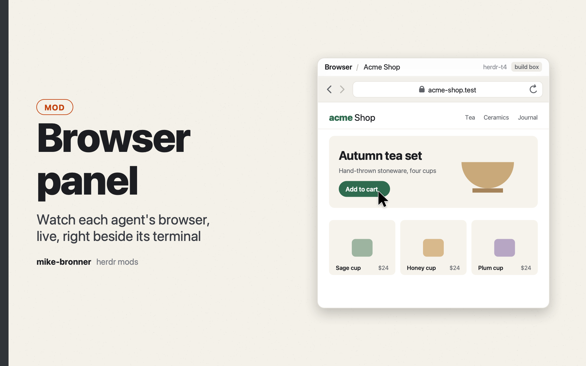

# herdr-browser-panel

A Browser panel for [Herdr.app](https://herdr.dev). It shows the focused
terminal's [agent-browser](https://agent-browser.dev/)
session live, beside Files and Changes, so you see the page your agent works
on and can click and type in it too.



## What it does

- Follows the focused terminal. Its session is `herdr-<terminal id>`, on that
  terminal's own machine: this computer, or a remote machine over an ssh
  tunnel.
- Starts the session when there is none. On a remote machine it starts the
  session in a Herdr terminal there, so the session keeps running, and removes
  that terminal once the start ends. It opens the project's address:
  1. the address the page was at when you last hid the panel in that Herdr
     space, or in that folder when the space is not known.
  2. a server listening from the terminal's folder.
  3. the last address used in that folder.
  4. the folder's Herd site, https when Herd holds the certificate.
  5. `APP_URL` from the project's `.env`.
  6. `about:blank`.
- Restarts a session that closes, except after a failed start, when a
  session it started by itself ended within 30 seconds, or when you closed it.
  Then it shows a **Start browser** button.
- Has a close button at the right end of the header, shown while the pointer
  is over the header, as on the terminal pane headers. It runs
  `agent-browser close` for the session on its own machine, which ends the
  session's daemon and Chrome. That terminal then waits for you to click
  **Start browser**. Other terminals still start their sessions. A failed
  close shows its error.
- Ends the shown terminal's session when you hide the panel, with the Browser
  button or by switching to Files or Changes. It runs the same close on the
  session's own machine. Other terminals' sessions keep running, and hiding
  only the Herdr window ends nothing. When you show the panel again, it starts
  a fresh session at the address from the list above. If the close or the
  start failed, it shows the error and waits for **Start browser**.
- Ends a terminal's session when the terminal closes, or when its workspace
  closes, on the terminal's own machine, shown or hidden. When the panel
  starts, it also ends each `herdr-<id>` session whose terminal no longer
  exists, such as one a Herdr quit or crash left behind.
  - Herdr keeps a closed terminal in its list as `finished`. The panel counts
    a finished terminal as gone.
  - It ends a session only after its terminal is missing or finished on two
    looks in a row, 4 seconds apart, so a terminal that shows as finished for
    a moment keeps its session.
  - It closes nothing on a machine it cannot see in full: before Herdr has
    loaded it, while it is disconnected, or while the terminal list fails.
  - It touches no session with another name, and no namespaced session.
- Offers an **Install agent-browser** button when agent-browser is missing.
- Has a Safari-style toolbar (Back and Forward, then an address field with
  Reload inside it), the page flush under it, and a header with the page
  title, the session and a machine chip. The header matches the terminal pane
  headers: it takes the layout's pane header height, or 30px.
- Fits the page to the panel's width. This overrides any viewport the agent
  set.
- Shows the page sharp on a Retina screen, for a session the panel starts.
  Chrome renders it at 2x, and the panel draws each frame pixel as one screen
  pixel, with no upscaling. The page reports a device pixel ratio of 2, as in
  a normal browser window.
- Shares input. Clicks and scrolls go to the page. After a click in the live
  picture, keys go to the page too, and a bar says so. A click outside the
  picture gives the keys back.

## Install

The repo has two mods:

- `mods/browser`: the panel.
- `mods/tabs-browser`: a copy of Herdr's tab bar with a Browser button after
  Files and Changes.

To install, ask your agent to follow [RECIPE.md](RECIPE.md). In short:

1. Copy both folders into `~/.config/herdr-app/mods/`, without overwriting
   anything.
2. Run `herdr-app check` on each one.
3. Change your own layout with `tools/add-browser.js`, from the root of a
   clone of this repo. It needs Node.js, and was tested on Node.js 24.20.0.
   It prints the layout with the tab bar pointed at `tabs-browser` and a
   `browser` block added to `panel-body`. Use the blocks in RECIPE.md's
   install steps 5 and 6. They keep a backup, check the output, show the
   diff, and only then copy the new layout over the old one.

- Never redirect the output onto the layout file itself. The shell empties
  the file first.
- After the switch, each space's remembered panel resets once, because each
  mod keeps its own storage.

## What it runs, reads and connects to

- **Runs programs** on the terminal's machine: `agent-browser`, `sh` scripts
  for session discovery and address detection, and `ssh` tunnels for remote
  terminals. On a remote machine, `agent-browser open` runs through
  `hc run --on <machine>`. `agent-browser close` runs only when you click the
  close button, hide the panel, or a terminal is gone. `hc ls --all --json`
  lists the terminals every 4 seconds. `brew` or `npm` installs run only when
  you click Install.
- **Reads** only the `APP_URL` line of a project's `.env`. To find the
  address it also reads Herd's config and site folder names,
  `public/hot`, agent-browser's session files, and which folder each
  listening server runs in.
- **Keeps** two address lists in the mod's local storage on this computer:
  the last address per folder, without its query or fragment, and the address
  you hid the panel at per Herdr space, whole, query and fragment included.
- **Writes** live frames to `~/.config/herdr-app/mods/browser-frames/`. Each
  is deleted after use, leftovers are swept after 6 minutes, and a
  `CACHEDIR.TAG` marker stays there. ssh logs go to
  `~/.config/herdr-app/data/browser/` and are deleted after each tunnel
  starts or fails.
- **Connects** only to 127.0.0.1. For a remote terminal, `ssh` connects to
  that machine and forwards its 127.0.0.1. The browser itself loads any page
  it is sent to, and an install downloads agent-browser and Chrome for
  Testing.

## For agents

Agents drive the panel's session with `agent-browser --session
"herdr-$HC_TERMINAL_ID"`. See
[skills/herdr-browser/SKILL.md](skills/herdr-browser/SKILL.md) for the rules
and a snippet for a project's `AGENTS.md`.

- Set a viewport with the scale 2, as in `agent-browser --session
  "herdr-$HC_TERMINAL_ID" set viewport 1280 800 2`. A bare `set viewport W H`
  drops the page to a device pixel ratio of 1.

## Limits

- A session the panel did not start, or one that ran before this version,
  streams 1x frames. The panel shows it correctly, but soft on a Retina
  screen. Close it with the header's close button, then click **Start
  browser**, to start it again at 2x.
- Chrome will not make its window narrower than 500px. The panel handles this
  by drawing only the page part of the frame and sending the viewport again,
  at 2x and at 1x.
- Tested with Herdr 0.1.18 and agent-browser 0.44.0.
- Forward is never dimmed.
- The tab bar clone must be redone by hand after Herdr updates its tabs mod.
  `mods/tabs-browser/mod.json` records the version it was cloned from.

## Tests

The tests cover the pure modules, the view's logic and the layout tool. They
need Node.js, and stub Herdr's modules, so Herdr is not needed.
`test/layout.test.js` passed on Node.js 24.20.0.

```sh
npm test
```

Run one file with `node --test test/layout.test.js`.

## License

- MIT, copyright 2026 Mike Bronner. See [`LICENSE`](LICENSE).
- The code adapted from deevs-herdr-kit, named under Credits, keeps its own MIT
  license and copyright line in `mods/browser/LICENSE-deevs-herdr-kit.txt`.

## Credits

Parts of `mods/browser` (the session discovery, stream, frames, input and ssh
tunnel code) are adapted from the agent-browser mod in
[deevs-herdr-kit](https://github.com/DeevsDeevs/deevs-herdr-kit), under its
MIT license. `mods/browser/LICENSE-deevs-herdr-kit.txt` lists the files and
holds that license.
