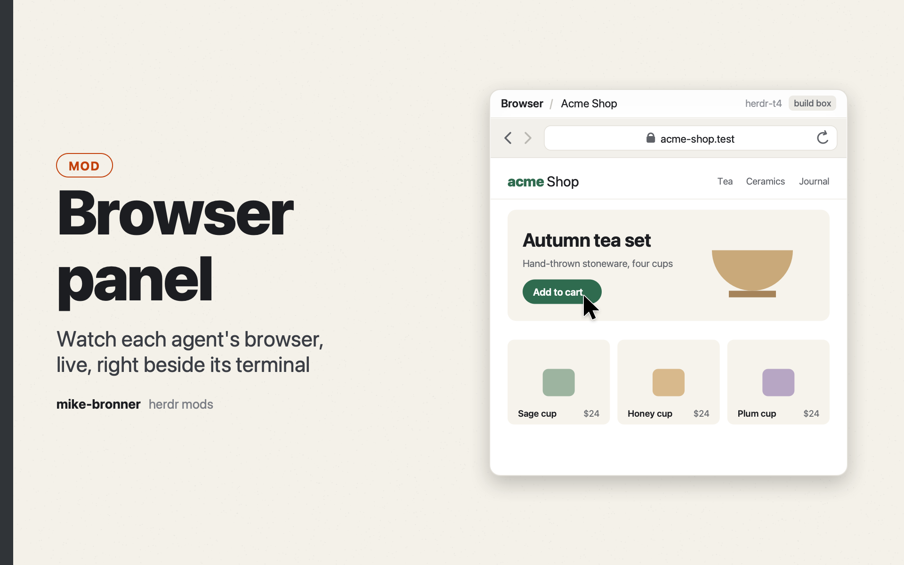

# Browser panel

A Browser panel on the right of the Herdr window, beside Files and Changes. It
shows the agent-browser session of the terminal that has focus, live, and lets
the person click, scroll and type in the same page the agent drives. A Browser
button in the tab bar opens and closes it.



## What you see

The panel is one block in the layout's `panel-body` stack, so it takes the
`panel` column's width and full height. Its frame has a 1px `border` line,
radius 10, on `background`. Text is 13px `foreground`. Top to bottom:

- **Header**, the same as a terminal pane's header: as high as the layout's
  pane header (`"pane": { "header": { "height": … } }`), or 30px when the
  layout sets none. 10px side padding, 8px gap, 12px text, 1px `border` line
  under it:
  - "Browser" in semibold.
  - While a page shows: a `/` in `dim` at 50% opacity, then the page title. The
    title is the active tab's title, or the page's host when the title is
    empty. It is cut with an ellipsis when it does not fit.
  - On the right, when the terminal has a session: the session name
    (`herdr-<terminal id>`) in `dim`, cut with an ellipsis past 160px, then a
    chip with the machine name, or "this computer". The chip is 18px high, 6px
    side padding, 11px `muted` text on `surface`, radius 5.
- **Toolbar**, only while a page shows. A `chrome` band with a 1px `border`
  line under it. It holds a 42px row, 8px side padding, 8px gap, and under it
  the note line and the keys bar when they show:
  - Back and Forward: a pair of 30x30 buttons at the left, side by side with
    no gap, with 18px chevron icons in `muted`. They turn `foreground` on a
    `hover` background, radius 6. Each has a tooltip. Both stay enabled,
    because agent-browser does not report the page's history.
  - Address field: centered in the rest of the row, at least 80px and at most
    640px wide, 30px high, radius 8, on `surface`, 13px text. At rest it shows
    the host without `www.`, centered. An https page puts a 12px lock icon in
    `muted` before the host. With no address it shows "Go to…" in `dim`.
  - Reload: a 22x22 button with a 13px icon inside the field's right end,
    styled like Back.
- **Note line**, for 4 seconds after a command fails: 12px text in `blocked`,
  such as `back: not connected`.
- **Keys bar**, 24px high, while the page takes the keyboard: `solid`
  background, `solid_foreground` 12px text, radius 6. It reads "Keys go to the
  page" in semibold, then "Herdr shortcuts too. Click outside the picture to
  give them back."
- **Page**: the live picture, flush with the panel's sides and bottom, on
  `surface`. Its bottom corners follow the panel's radius. While the page takes
  the keyboard, a 2px `accent` line runs round it. The picture keeps the
  page's own proportions and is centered in this area. Over it, in 12px
  `dim`, it can say "Connecting…", "Waiting for the page to paint…", "Cannot
  reach the live view: <reason>" or "This session has no live view."

When no page shows, the toolbar and page give way to a body with 14px
padding and one of these:

- "Focus a terminal to see its browser."
- "Looking for herdr-t6 on this computer…" or "Starting herdr-t6 on this
  computer…".
- "Cannot check <machine> for <session>." in `blocked`, with the error under it.
- "Terminal <id> has no usable session name." in `blocked`.
- "No browser for this terminal yet." with a **Start browser** button: 28px
  high, radius 6, `solid` with `solid_foreground` text. Any error shows under
  it in `blocked`.
- "agent-browser is not installed on <machine>." with an **Install
  agent-browser** button and a line that names the exact commands it runs.
  When no installer fits, or an install failed, it shows the command to run by
  hand in a `surface` box with a Copy button.
- While installing: a spinner, "Installing agent-browser on <machine> with
  Homebrew…" (or npm), "Step 1 of 2: brew install agent-browser", and a line
  that says it can take several minutes.

The tab bar is Herdr's own, with one more button after Files and Changes: a
globe icon (`browser.svg`, 14px) and "Browser", 26px high, 12px text, radius
6. It is on `selected` while the panel shows the browser, else on `chrome`.

## How it behaves

- **Follows focus.** The panel shows the session of the focused terminal. A
  terminal's session is `herdr-<terminal id>`, on that terminal's own
  machine. Ids with characters other than ASCII letters, digits, `-` and `_`
  get no session. A namespaced session never counts.
- **Works only while shown.** It looks for the session every 4 seconds, and
  only while the window is visible and the browser is the stack's shown
  child. Hiding the panel, hiding the window or focusing another terminal
  closes the stream and its tunnel.
- **Starts the session.** When the focused terminal has no session, the panel
  starts one with `agent-browser --session herdr-<id> open <address>`, then
  `stream enable`. The address is the first of:
  1. a server listening on 127.0.0.1, `::1` or all addresses, whose process runs
     inside the terminal's folder (the lowest port wins, and the Vite port in
     `public/hot` is skipped). Not used when the folder is the home folder
     or above it.
  2. the last address the panel saw in that folder, without its query or
     fragment.
  3. the folder's Herd site, https when Herd holds a certificate for it.
  4. `APP_URL` from the nearest `.env`, from the folder up to below the home
     folder, if it is http or https.
  5. `about:blank`.
- **Joins an existing session.** A session that already runs is connected to,
  never navigated.
- **Restarts a closed session**, at the address above, unless:
  - the last start failed: it shows the error and **Start browser**.
  - the panel started the session itself and it ended within 30 seconds: it
    shows **Start browser**.
- **Sets the viewport.** It sends the page area's size, at 1x, each time the
  page shows, the panel is resized (at most every 250 ms) and the stream
  reconnects. This replaces any viewport the agent set. A refused size is sent
  again after 1 s, doubling to 15 s.
- **Shares input.**
  - A left or right click in the picture goes to the page. Dragging works.
  - The scroll wheel over the picture scrolls the page.
  - After a click in the picture, while the stream is live, every key goes to
    the page, Herdr shortcuts included, and the keys bar shows. Cmd-V or
    Ctrl-V types the clipboard text, up to 2000 characters. A click outside
    the picture gives the keys back.
- **Toolbar.** Back, Forward and Reload send those commands. A click on the
  address field shows the full address, selected. Enter goes to it, with
  `https://` added when there is no scheme. Escape cancels. The field follows
  the page's address while it is not being edited.
- **Install button.** Shown only when agent-browser is missing on that
  machine. It uses Homebrew if present, else npm with Node.js 22 or later:
  `brew install agent-browser` or `npm install -g agent-browser`, then
  `agent-browser install`. On Linux as root, or with passwordless sudo
  (checked with `sudo -n true`), the second step is
  `agent-browser install --with-deps`. Each step times out after 10 minutes.
- **Stream.** Up to 15 frames a second. A dropped stream retries after 1 s,
  doubling to 15 s.
- **Tab bar.** The Browser button shows whenever `panel-body` holds a block
  with the id `browser`. A click selects and shows it, and a second click
  hides the panel, as Files and Changes do. The panel picked for each space
  is remembered, Browser included. Tab statuses (a spinner for working, a 6px
  `blocked` or `done` dot) and every other control are as in Herdr's tabs mod.

## Built from

**Layout.** Two changes to the person's own layout:

- The tab bar block's `content.mod` changes from `tabs` to `tabs-browser`.
- `panel-body`, a `stack`, gets one more child:
  `{ "id": "browser", "type": "block", "content": { "mod": "browser" } }`.

`tools/add-browser.js <layout.json>` makes both changes and prints the
result. It never writes a file. It refuses a layout with no tabs block, with
no `panel-body` stack, or with an id `browser` that is not this block. Run on
a layout that has the change already, it prints the same layout.

**`mods/browser`**, `mod.json` `{ "place": "none", "title": "Browser" }`, no
props:

- `main.js`: the view.
- `panel.js`: focus to session name, panel states, restart rules.
- `address.js`: the address detection script and its parser.
- `discovery.js`: the session discovery script and its parser.
- `install.js`: install plans.
- `page.js`: input messages, picture fit, viewport steps, the ssh tunnel
  arguments.
- `connect.js`: the direct connection, or the ssh tunnel through
  `hc run --bg`.
- `stream.js`: the WebSocket stream, frame pacing, input queue, commands.
- `frames.js`: frames written as JPEG files and shown as images.
- Art: `back.svg`, `forward.svg`, `reload.svg`, `lock.svg`.
- `herdr` functions: `exec`, `hc`, `focused`, `spaces`, `panes`, `theme`,
  `window`, `layout`, `settings`, `checking`, `appHome`, `readTextFile`,
  `watchFolder`. Also `net`, `fs/promises`, `websocket`, `fetch` and
  `localStorage` (`lastUrls`, at most 200 folders).
- `hc` commands: `machine ls --json`, `get <name> --json`, `run --bg --rm`,
  `kill <name>`.

**`mods/tabs-browser`**, `mod.json` with `cloned_from` `tabs` 0.1.18: a copy of
Herdr's shipped `tabs` mod with these changes only:

- `panels.js`: `panelIds(enabled, body)` adds `browser` when `panel-body`
  holds it.
- `main.js` imports it, passes its list to `syncPanel`, and adds the Browser
  button after Changes.
- Its window-button icons point at `mods/tabs-browser/`, which holds copies of
  `win-min.svg`, `win-max.svg`, `win-restore.svg` and `win-close.svg`, plus
  `browser.svg`.
- It still uses shipped art (`mods/files/file.svg`, `mods/changes/changes.svg`,
  `mods/pane/close.svg`, `mods/workspace-chrome/spinner.svg`) and the shipped
  `menu` and `new-menu` overlays.
- `herdr` functions: `spaces`, `panes`, `run`, `openOverlay`, `theme`,
  `window`, `shared`, `layout`, `settings`. Also `localStorage` (`panels`,
  the panel picked for each space).
- Commands: `tab.prev`, `tab.next`, `tab.select`, `tab.move`, `tab.rename`,
  `tab.close`, `layout.select`, `layout.show`, `layout.hide`,
  `window.minimize`, `window.maximize`, `window.close`.

**What the mods run, read, write and connect to.** Tell the person this
before you install:

- **Programs**, on the terminal's machine through `exec`:
  - `agent-browser` (`open`, `stream enable`, `install`).
  - `sh` scripts for session discovery and address detection. They use
    standard tools, such as `ss` or `lsof`, `grep`, `sed` and `node -v`.
  - `brew` or `npm`, and `sudo -n true` on Linux, only after the Install
    button is clicked.
  - `ssh` for a remote terminal, through `hc run`. It needs a plain ssh
    target and key login (`BatchMode=yes`).
- **Reads outside its folder**, on the terminal's machine:
  - only the `APP_URL` line of the nearest `.env`.
  - the first line of `public/hot` in the terminal's folder.
  - Herd's `config.json`, its certificate file names, and the folder names in
    Herd's site paths.
  - agent-browser's session files (`.pid`, `.stream`, `.engine`, `.target`)
    in its socket folders.
  - the working folder of each listening process.
- **Writes outside its folder:** frames to
  `~/.config/herdr-app/mods/browser-frames/` (each deleted after use, and
  leftovers swept after 6 minutes), plus a `CACHEDIR.TAG` marker there that
  stays, and ssh logs to `~/.config/herdr-app/data/browser/`
  (deleted after each tunnel starts or fails).
- **Network:** the mods connect only to 127.0.0.1: the stream's WebSocket, its
  HTTP command endpoint, and the local end of an ssh tunnel to the remote
  machine's 127.0.0.1. The `ssh` program connects to the remote machine's ssh
  target. The browser itself loads whatever page it is sent to, and an
  install downloads agent-browser and Chrome for Testing.

**Install into a setup.** The worked example is the author's own install:
both mods copied into `~/.config/herdr-app/mods/`, and the layout change
applied to `layouts/mine.json`. Run these from a clone of this repo.

1. Read this recipe and every file. Tell the person what the mods run, read,
   write and connect to, from the list above.
2. Check that neither name is taken. Both of these must say "No such file":

   ```sh
   ls -d ~/.config/herdr-app/mods/browser ~/.config/herdr-app/mods/tabs-browser
   ```

   If a name is taken, rename the new mod, as Watch out describes. Never copy
   over a mod that is there.
3. Copy the two mod folders, and check each one:

   ```sh
   cp -R mods/browser mods/tabs-browser ~/.config/herdr-app/mods/
   herdr-app check ~/.config/herdr-app/mods/browser
   herdr-app check ~/.config/herdr-app/mods/tabs-browser
   ```

4. Ask the person which of their own layouts gets the panel. The example uses
   `mine.json`.
5. Make the new layout beside the old one, and show the change. Run this
   block whole, from the root of the clone. It needs Node.js, and was tested
   on Node.js 24.20.0. It keeps a backup in `~/mine.json.before-browser` and
   writes the new layout to `~/mine.json.with-browser`. It stops, with the
   layout untouched, if either file already exists, or if `add-browser.js`
   fails or prints nothing:

   ```sh
   (
     set -e
     layout=~/.config/herdr-app/layouts/mine.json
     for f in ~/mine.json.before-browser ~/mine.json.with-browser; do
       [ ! -e "$f" ] || { echo "$f exists: move it away first"; exit 1; }
     done
     node tools/add-browser.js "$layout" > ~/mine.json.with-browser && [ -s ~/mine.json.with-browser ] || {
       rm -f ~/mine.json.with-browser
       echo "add-browser failed, layout untouched"
       exit 1
     }
     cp "$layout" ~/mine.json.before-browser
     diff "$layout" ~/mine.json.with-browser || [ $? -eq 1 ]
   )
   ```

   `diff` exits 1 when it finds a change, which is expected here. Exit 2
   means it could not compare, and the block fails. The tool writes JSON with
   2-space indents, so a file in another format also shows whitespace
   changes. Apart from those, the diff must show only the `tabs-browser` line
   and the new `browser` block. A layout that has the change already shows no
   difference.
6. When the diff is right, copy the new layout over the old one, and remove
   the new file. `cat` keeps the layout file's own mode:

   ```sh
   [ -s ~/mine.json.with-browser ] && cat ~/mine.json.with-browser > ~/.config/herdr-app/layouts/mine.json && rm ~/mine.json.with-browser
   ```

   Herdr applies a layout file when it is saved. To undo, copy
   `~/mine.json.before-browser` back the same way.

## Watch out

- **Never redirect `add-browser.js` onto the layout it reads.** The shell
  empties the file before Node reads it. Write to a separate file, check that
  it is not empty and that the diff is right, then copy it over the layout,
  as install steps 5 and 6 do. An empty output means the tool failed.
- The layout must be the person's own file. Herdr's own layouts are
  read-only and replaced on every start.
- After the switch to `tabs-browser`, each space's remembered panel resets
  once, because `localStorage` belongs to each mod.
- The names are fixed in code. `browser` is the mod folder, the block id, the
  `mods/browser/` icon paths and the `mods/browser-frames` folder.
  `tabs-browser` is in its own icon paths. Renaming either mod means changing
  these strings and the layout.
- The tabs clone does not follow Herdr's updates. After Herdr updates its
  `tabs` mod, copy the new `main.js`, apply the changes listed in Built from
  again, and update `cloned_from`.
- Frames are 1x, so the page looks soft on a Retina screen. agent-browser's
  stream sends frames at the page's CSS size.
- Chrome will not make its window narrower than 500px. Below that, a frame
  can show the whole window. The panel draws only the page part, and sends
  the same viewport again, at most 3 times, which makes Chrome correct it.
- Forward is never dimmed, even with nowhere to go. Back is not dimmed either.
- The panel turns on streaming only for a session it opens itself. A session
  with no stream port shows "This session has no live view." Whether
  agent-browser streams a session it was not asked to is not verified here.
- A remote machine reached through another machine (`via`) cannot be shown.
- There is no `keys.json`.
- Tested with Herdr 0.1.18 and agent-browser 0.44.0. Other versions are not
  verified.

## Done when

- `herdr-app check ~/.config/herdr-app/mods/browser` and
  `herdr-app check ~/.config/herdr-app/mods/tabs-browser` exit 0.
- The tab bar shows a Browser button after Changes, and a click opens the
  panel with "Browser" in its header.
- With a terminal focused in a project folder, the panel shows
  "Starting herdr-<id> on this computer…", then the live page: the project's
  address if one is found, else a blank page.
- `agent-browser --session "herdr-$HC_TERMINAL_ID" get url`, run in that
  terminal, prints the address the panel shows.
- A click in the picture shows the keys bar, and typed text reaches the page.
  A click outside gives the keys back.
- Focusing another terminal shows that terminal's session name in the header.
